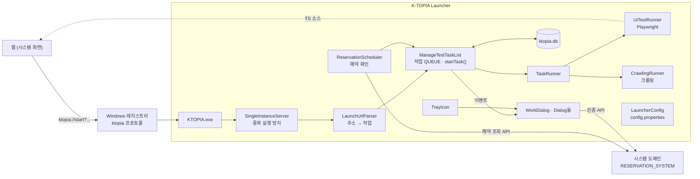
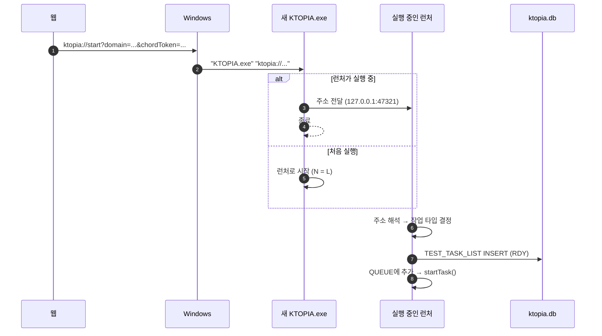
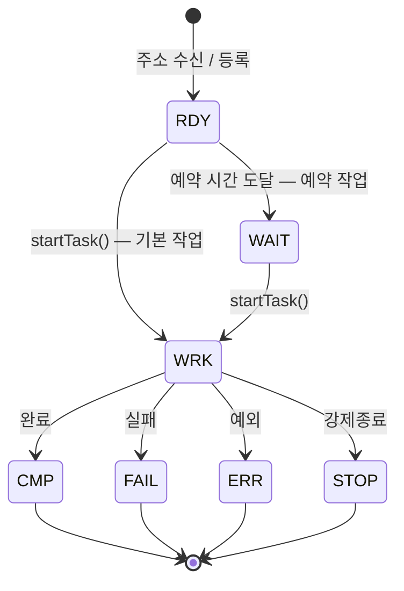
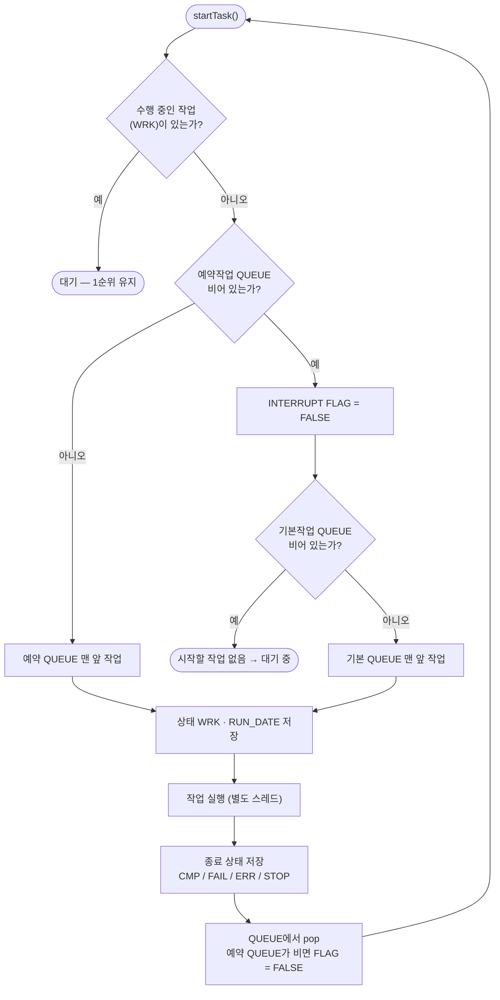
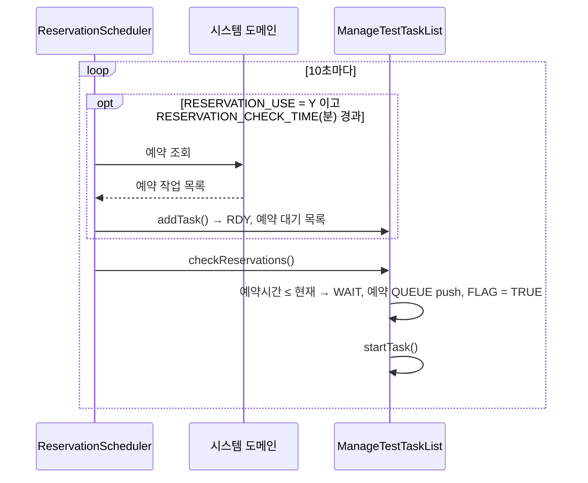
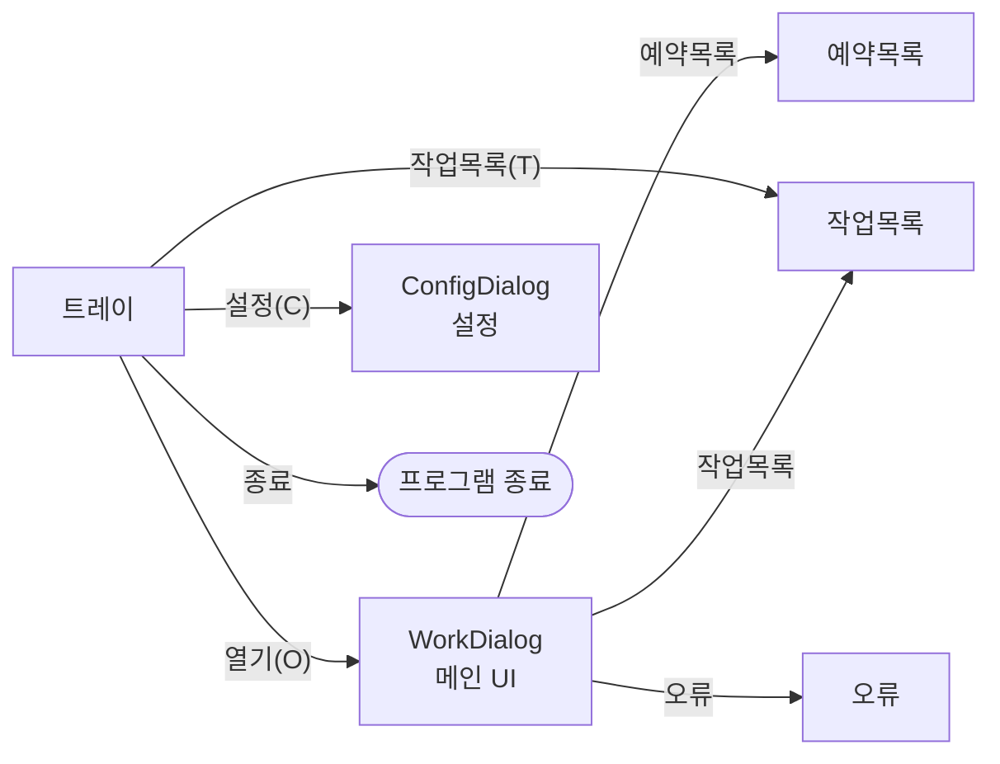
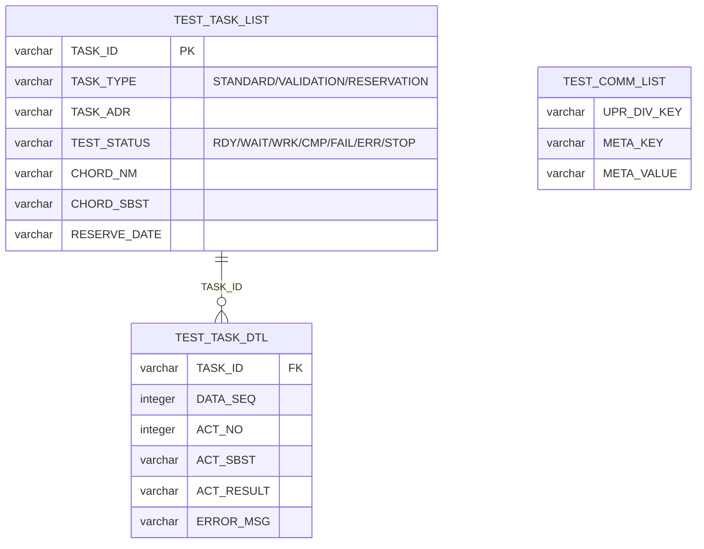
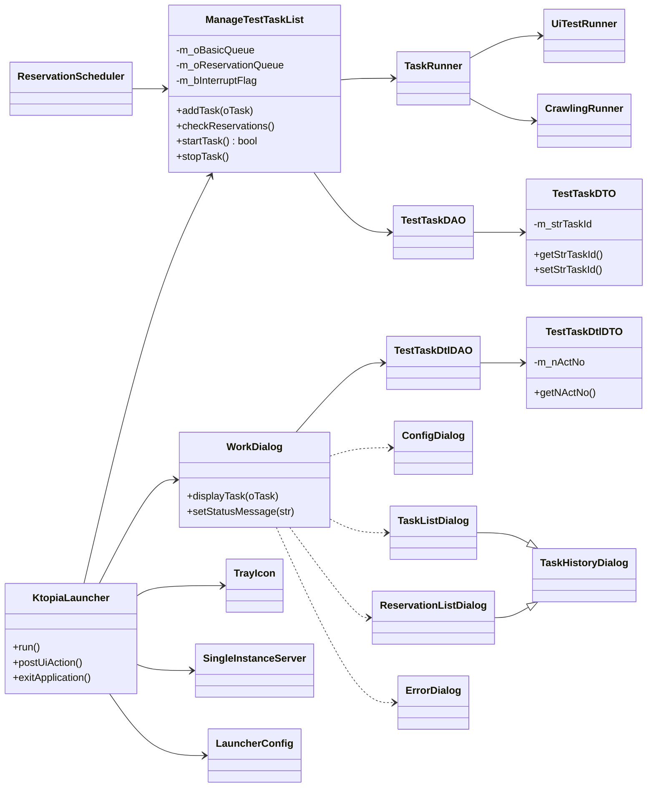

# K-TOPIA Launcher 설계서

| 항목 | 내용 |
|---|---|
| 문서 버전 | 0.1 |
| 작성일 | 2026-11-06 |
| 대상 프로그램 | K-TOPIA Launcher (`KTOPIA.exe`) v0.1.0 |
| 관련 문서 | [개발 문서](DEVELOPMENT.md) · [코드 규칙](CodeConvention_python.md) · [클래스 명세](spec/) |

> 그림은 Mermaid로 작성했다. GitHub, GitLab에서는 바로 보이고, VS Code 미리보기에서는 *Markdown Preview Mermaid Support* 확장이 필요하다.

---

## 목차
1. [개요](#1-개요)
2. [시스템 구성](#2-시스템-구성)
3. [실행 방법](#3-실행-방법)
4. [작동 원리 (작업)](#4-작동-원리-작업)
5. [UI](#5-ui)
6. [설정](#6-설정)
7. [데이터](#7-데이터)
8. [객체 (DTO)](#8-객체-dto)
9. [클래스 구성](#9-클래스-구성)
10. [미정 사항](#10-미정-사항)

---

## 1. 개요

### 1.1 개발 의의
K-TOPIA Launcher는 **UI TEST**와 **DB 테스트**를 수행하기 위한 Windows 데스크톱 프로그램이다.

| 구분 | 내용 |
|---|---|
| 수행 작업 | 크롤링(crawling)과 UI TEST를 모두 런처에서 진행한다 |
| 실행 방식 | 웹에서 `ktopia://` 주소를 부르면 런처가 실행되면서 해당 동작을 자동으로 수행한다 |
| UI TEST | Playwright를 사용한다. 웹에서 Playwright **TypeScript** 소스를 받아서 진행한다 |
| 상주 | 트레이에 상주하며, 트레이의 종료 메뉴로만 프로그램이 끝난다 |

### 1.2 기술 구성
| 구분 | 사용 |
|---|---|
| 언어 | Python 3.12 |
| 화면 | tkinter (메인 UI·Dialog), pystray (트레이), Pillow (아이콘) |
| DB | SQLite (`resource/db/ktopia.db`), SQL은 XML(`initSql.xml`, `mainSql.xml`) |
| 배포 | PyInstaller 단일 실행 파일 `KTOPIA.exe` |
| UI TEST 실행 (예정) | Node.js + Playwright (`NODEJS_PATH`, `PLAYWRIGHT_PATH`) |

---

## 2. 시스템 구성



### 2.1 스레드 구성
tkinter는 UI 스레드에서만 다룰 수 있으므로, 다른 스레드의 요청은 **UI 큐**를 거쳐 UI 스레드가 100ms마다 처리한다.

| 스레드 | 하는 일 |
|---|---|
| UI (메인) | 화면, UI 큐 처리 |
| TaskWorker | 작업 1건 실행 (한 번에 하나) |
| ReservationScheduler | 10초마다 예약 확인 |
| SingleInstanceServer | 두 번째 실행에서 넘어온 주소 수신 |
| TrayIcon | 트레이 메뉴 |

---

## 3. 실행 방법

### 3.1 실행 경로
| 경로 | 동작 |
|---|---|
| `KTOPIA.exe` 직접 실행 | 런처 시작, 메인 UI 표시 |
| 웹에서 `ktopia://...` 호출 | 런처가 꺼져 있으면 실행, 켜져 있으면 실행 중인 런처로 주소 전달 → 작업 등록 |
| 이미 실행 중일 때 exe 다시 실행 | 실행 중인 런처의 메인 UI를 앞으로 |

### 3.2 레지스트리 등록
설정 `LINK_REGST_IND=Y`(기본)이면 런처가 시작할 때 아래를 등록한다. `N`이면 삭제한다. 현재 사용자 영역이라 관리자 권한이 필요 없다.

```
HKEY_CURRENT_USER\Software\Classes\ktopia
    (기본값)        = "URL:ktopia Protocol"
    URL Protocol    = ""
    DefaultIcon     = "<설치경로>\KTOPIA.exe",0
    shell\open\command
        (기본값)    = "<설치경로>\KTOPIA.exe" "%1"
```

### 3.3 실행 주소
공통 형식: `ktopia://start?domain=<URL 인코딩된 도메인>&...` — 웹의 도메인을 `domain` GET 파라미터로 넘긴다.
`ktopia://start?....` 문장 전체를 **주소**라고 한다.

| 작업 | 판단 조건 (위에서부터) | TASK_TYPE | 실행 프로세스 |
|---|---|---|---|
| 크롤링 | `mode=CRAWLING` | **CRAWLING** | 크롤링 |
| UI TEST | `reqProdSeq`, `exeSeq`, `chordId` 가 있음 | **STANDARD** | Playwright UI TEST |
| 검사(크롤링) | `chordToken` 이 있음 | **VALIDATION** | 크롤링 |

**주소 저장과 파싱**
- 주소가 오면 작업 객체(TestTaskDTO)를 만들어 TaskList에 add한다 = TEST_TASK_LIST에 insert(`insertTestTask`). TEST_STATUS=**RDY**, TASK_ID=`Util.makeTaskId()`(`yyyyMMddHHmmss` + 1000부터 증가하는 순번).
- **TASK_ADR = 주소 전체**, 웹이 보낸 모양 그대로(값 인코딩 유지).
  - Windows는 `ktopia://start?…`를 `ktopia://start/?…`로 바꿔 넘긴다(서버 이름 자리 뒤에 `/`를 넣는 표준화). 저장할 때 `/`를 빼서 되돌린다.
- 파싱: 첫 `?` 다음부터 → 첫 번째 구분자 `&`로 나눔 → 두 번째 구분자 `=`(첫 `=`만)로 이름·값 나눔 → 값 디코딩. 이름은 대소문자 무시.

**크롤링 예 (리허설)**
```
ktopia://start?domain=http%3A%2F%2Flocalhost%3A8082&systemId=UI_SYSTEM_261126141219738&mode=CRAWLING
```

**UI TEST 예**
```
ktopia://start?domain=http%3A%2F%2Flocalhost%3A8080&reqProdSeq=2026110545689811556&exeSeq=1&chordId=300157224&chordType=UITEST
```

**검사(chordToken) 예**
```
ktopia://start?domain=http%3A%2F%2Flocalhost%3A8080&chordToken=ks7dfenv20455eoed&chordType=UITEST
```

**파라미터 → 컬럼**

| 파라미터 | 컬럼 | 설명 |
|---|---|---|
| (주소 전체) | TASK_ADR | 웹이 보낸 주소 그대로 |
| `domain` | — | 웹 도메인 (필수). TASK_ADR 안에 있음 |
| `mode` | TASK_TYPE | `CRAWLING`이면 CRAWLING |
| `systemId` | CHORD_ID | 시스템 ID (CRAWLING 필수) |
| `reqProdSeq` | REQ_PROD_SEQ | 플랜 ID (수행 SR) |
| `exeSeq` | EXE_CD | 수행 Inst Seq |
| `chordId` | CHORD_ID | chord ID |
| `chordType` | CHORD_TYPE | chord 타입 |
| `chordToken` | CHORD_ID | chord 토큰 (크롤링) |
| — | SYS_TRTR_ID | 지금은 저장하지 않음 |

### 3.4 실행 순서



---

## 4. 작동 원리 (작업)

### 4.0 런처 시작 init
런처가 켜지면 메인 화면(WorkDialog)이 `init()`을 실행한다. 웹에서 받은 주소는 init이 끝난 뒤 처리한다.

| 순서 | 내용 | 처리 |
|:---:|---|---|
| 1 | 런처 버전 체크 | 현재 버전은 `.launcher` 파일에서 읽음, 최신 버전은 시스템 도메인 API (예정) |
| 2 | `initMappingQuery()` | mainSql `type=S` → selectQueryMap, `I/U/D` → executeQueryMap, initSql → systemQueryMap |
| 3 | Node.js 설치 체크 | `NODEJS_PATH\node.exe` |
| 4 | Playwright 설치 체크 | `PLAYWRIGHT_PATH\node_modules\@playwright\test` |
| 5 | 지금 구동되어야 할 업무 체크 | DB의 RDY 작업을 기본 QUEUE로 → startTask() |
| 6 | 예약된 업무 체크 | DB의 RDY·WAIT 예약 작업을 불러와 시간이 된 것은 예약 QUEUE로 |

결과는 메인 화면 상태 표시("초기화 완료" 또는 "초기화 완료 (Node.js 없음, …)")와 로그에 남는다.

### 4.1 작업 상태
| 코드 | 이름 | 설명 | 종료 상태 |
|---|---|---|:---:|
| RDY | 대기중 | 등록됨 | |
| WAIT | 작업준비중 | 예약 시간이 되어 예약 QUEUE에 들어감 (**예약 전용**) | |
| WRK | 작동중 | 실행 중 | |
| CMP | 완료 | 정상 종료 | ✔ |
| FAIL | 실패 | 테스트가 실패로 끝남 | ✔ |
| ERR | 오류 | 실행 중 예외 | ✔ |
| STOP | 강제종료 | 중지 요청·프로그램 종료 | ✔ |



### 4.2 QUEUE와 INTERRUPT FLAG
작업은 `ManageTestTaskList`가 관리한다. 선입선출 QUEUE 2개로 나뉜다.

| QUEUE | 들어가는 작업 |
|---|---|
| **기본작업 QUEUE** | STANDARD, VALIDATION — 등록 즉시 |
| **예약작업 QUEUE** | RESERVATION — 예약된 작업시간이 되었을 때 |

- 예약작업이 예약 QUEUE에 push되면 **INTERRUPT FLAG = TRUE**
- 예약 QUEUE가 EMPTY가 되면 **INTERRUPT FLAG = FALSE**
- FLAG가 TRUE인 동안 기본 QUEUE는 **push만 되고 pop은 멈춘다**

### 4.3 우선순위
| 순위 | 대상 |
|:---:|---|
| 1 | 지금 수행되고 있는 작업 (WRK) — 끝날 때까지 다른 작업을 시작하지 않는다 |
| 2 | 예약작업 QUEUE (비어 있으면 다음으로) |
| 3 | 기본작업 QUEUE |

**한 번에 하나의 작업만 실행된다.** 작업이 끝나면 결과 상태가 저장되고, 그 다음에 QUEUE에서 pop된다.

### 4.4 startTask()
**작업이 ADD될 때**와 **작업 하나가 끝났을 때**(CMP·FAIL·ERR·STOP) 호출되어, 다음에 수행할 작업이 있는지 확인하고 시작한다.



### 4.5 예약 작업


### 4.6 작업 실행기
| TASK_TYPE | 실행기 | 하는 일 |
|---|---|---|
| STANDARD | UiTestRunner | 웹에서 받은 Playwright TypeScript 소스를 Node.js로 실행, 동작별 결과를 TEST_TASK_DTL에 기록 |
| RESERVATION | UiTestRunner | 위와 같음 |
| CRAWLING | CrawlingRunner | 크롤링 — whl `crawling` 패키지의 CrawlerEngine 사용 (아래 4.7) |
| VALIDATION | CrawlingRunner | 크롤링 |

- `MINIMIZE_IND = Y`이면 UI TEST를 HEADLESS로 진행한다.
- 캡처는 `SAVE_PATH`에 저장한다.

### 4.7 크롤링 업무 (CrawlingRunner)
주소: `ktopia://start?domain=<도메인>&mode=CRAWLING&systemId=<시스템 ID>` — `domain`·`mode`는 모든 주소에 붙고, 뒤의 파라미터는 mode에 따라 다르다.

1. TEST_STATUS = WRK
2. 서버에 업무 정보 요청 — `SystemApiClient.getServerData(domain, systemId, type)` (type에 따라 서버가 다른 정보를 보낼 수 있다)
3. 받은 정보를 파싱해 작업 객체와 멤버변수 map에 저장 (업무가 바뀌면 멤버변수 초기화)
4. 로그인 여부(`loginYn`)에 따라 진행
   - N: 로그인 없이 TEST_COMM_LIST에 시스템 정보 저장 — META_KEY 시스템ID, UPR_DIV_KEY `PL_UI_SYSTEM_INFO`, DIS_NM 시스템 이름, ALIAS_NM 시스템 URL, META_VALUE `loginYn:N,expMin:0`
   - Y: `CrawlerEngine.login()` + 런처의 **로그인 안내** 창. [확인] → 로그인 완료. 세션 json이 저장되면 시스템 정보 저장 — META_VALUE `loginYn:Y,expMin:20`, VALUE_DESC `sessionSaveDt:<세션 저장 일시>`
5. 크롤링 — `CrawlerEngine.crawl()`
6. 결과 보내기 — **지금은 콘솔에 "보내기"만** (예정: 결과 json `sendCrawlingRslt(strDomain, strRequest)` → 결과 파일 `uploadMultiFiles(...)`)
7. 성공: TEST_RESULT **Y**, TEST_STATUS **CMP**
8. `startTask()` — 업무가 끝나면 결과와 상관없이 다음 업무로

| 실패 | TEST_RESULT | TEST_STATUS |
|---|---|---|
| 서버 API 통신 실패 (모든 서버 API) | N | ERR |
| 로그인 · 크롤링 실패 | N | FAIL |

상세: [spec/runner/CrawlingRunner.md](spec/runner/CrawlingRunner.md)

---

## 5. UI

### 5.1 화면 관계


**모달 규칙:** 자식 Dialog가 열리면 부모 Dialog는 사용자가 조작할 수 없다(시스템에 의한 화면 갱신은 허용). 자식 Dialog를 닫아야 부모를 조작할 수 있다.

**화면 스타일** (ttkbootstrap 밝은 테마 `flatly`, 규칙은 `ui/UiTheme`)

| 항목 | 규칙 |
|---|---|
| 글꼴 | 맑은 고딕 9pt, 라벨·표 머리글은 굵게 |
| 표 | 남색 머리글, 줄 높이 26 |
| 상태 색 | 완료 초록 · 실패/오류 빨강 · 강제종료 주황 · 작동중 파랑 · 대기/준비 회색 |
| 버튼 | 글자에 맞는 작은 버튼. 주 버튼은 남색, 위험(오류)은 빨간 테두리, 보조는 회색 테두리 |
| 창 크기 | 100% 기준 크기로 고정, Windows 배율(예: 125%)만큼 확대되어 보임 |

### 5.2 메인 UI — WorkDialog
- 타이틀 **K-TOPIA Launcher**, 크기 고정
- 최소화·닫기 버튼만 활성화. **닫기를 눌러도 종료되지 않고 트레이에 남는다**

```
┌─ K-TOPIA Launcher ───────────────────────────────── _  ✕ ┐
│ 테스트 명    로그인 화면 UI 테스트                         │  ← CHORD_NM
│ 테스트 내용  로그인 화면에서 아이디/비밀번호 입력 후 …      │  ← CHORD_SBST (3줄)
│                                                          │
│ ┌──────┬──────────────────────────────────┬──────────┐   │
│ │  No  │ 테스트명                          │   결과   │   │  ← TEST_TASK_DTL (남색 머리글)
│ ├──────┼──────────────────────────────────┼──────────┤   │     (TASK_ID, ACT_NO 순)
│ │  1   │ 아이디 입력                       │  ✔ 성공  │   │  ← 초록
│ │  2   │ 비밀번호 입력                     │  ✔ 성공  │   │  ← 초록
│ │  3   │ 로그인 버튼 클릭                  │  ✖ 실패  │   │  ← 빨강
│ └──────┴──────────────────────────────────┴──────────┘   │
│──────────────────────────────────────────────────────────│
│ ● 작업 수행 중 : 로그인 화면 UI 테스트 [예약목록][작업목록][오류]│  ← ● 작업 상태 색
└──────────────────────────────────────────────────────────┘
```

| 영역 | 내용 |
|---|---|
| 테스트 명 / 테스트 내용 | 지금 수행하는(WRK) 작업의 CHORD_NM / CHORD_SBST |
| 표 | 자식 테이블 TEST_TASK_DTL에서 현재 작업(TASK_ID)의 동작을 ACT_NO 순으로. NO는 1~N, 테스트명은 ACT_SBST, 결과는 ACT_RESULT |
| 상태표시 | 작업 상태가 바뀔 때마다 메시지 (작업 등록 / 수행 중 / 종료 / 대기 중), 앞의 ● 점은 작업 상태 색 |
| 버튼 | 예약목록(회색 테두리), 작업목록(남색), 오류(빨간 테두리) — 각 Dialog 열기 |

작업이 바뀌면 테스트 명·테스트 내용·표가 새 작업 내용으로 다시 로드된다.

### 5.3 트레이
| 메뉴 | 동작 |
|---|---|
| 열기(O) | 메인 UI 열기 (아이콘 더블클릭과 같음) |
| 작업목록(T) | 메인 UI를 열고 작업목록 Dialog |
| 설정(C) | 메인 UI를 열고 설정 Dialog |
| 종료 | 수행 중 작업을 STOP 처리하고 **프로그램 종료** |

### 5.4 작업목록 / 예약목록
| 구분 | 작업목록 | 예약목록 |
|---|---|---|
| 대상 | TASK_TYPE ≠ RESERVATION | TASK_TYPE = RESERVATION |
| 정렬 | 최근 등록순 (맨 위가 최신) | 최근 등록순 |
| 컬럼 | No(1~N), 테스트명, 작업타입, 상태, 결과, 수행시간(RUN_DATE) | No(1~N), 테스트명, 상태, 결과, 예약일시, 수행시간(RUN_DATE) |
| 갱신 | 창이 열려 있는 중에도 작업 상태가 바뀌면 다시 그린다 | 같음 |

```
┌─ 작업목록 ───────────────────────────────────────────────── ✕ ┐
│ No  테스트명    작업타입  상태        결과   수행시간            │
│  1  ks7dfe…     검사      완료(CMP)   …      2026-11-06 17:18:08 │
│  2  300157224   기본수행  완료(CMP)   …      2026-11-06 17:18:05 │
│                                                               │
│ 전체 2건                                              [닫기]   │
└───────────────────────────────────────────────────────────────┘
```

### 5.5 오류
메인 UI에 표시 중인 작업에서 발생한 오류 메시지를 보여준다.
```
작업 : 2026110617130764651300

[작업 오류] TimeoutError: locator('#loginBtn') 30000ms 초과     ← TEST_TASK_LIST.ERR_MSG
[동작 3] TimeoutError : 요소를 찾을 수 없음                      ← TEST_TASK_DTL.ERROR_CLASS / ERROR_MSG
```

### 5.6 설정 — ConfigDialog
```
┌─ 설정 ─────────────────────────────────────────────────── ✕ ┐
│ 시스템 도메인       [http://www.ktopia.co.kr              ]   │
│ 설치 경로           [D:\PLauncher\dist                     ]   │ ← 읽기 전용
│ 웹에서 런처 실행    [✔] 사용                                  │
│ 예약 기능           [ ] 사용                                  │
│ API 토큰            [**********************] [인증] 인증됨   │
│ Node.js 경로        [D:\PLauncher\dist\node                ]   │ ← 읽기 전용
│ Playwright 경로     [D:\PLauncher\dist\playwright          ]   │ ← 읽기 전용
│ 최소화(HEADLESS)    [ ] 사용                                  │
│ 캡처 저장 경로      [D:\PLauncher\dist\screenShot          ]   │ ← 읽기 전용
│ 예약 체크 타임(분)  [ 5 ▲▼]                                   │
│                                                [적용] [닫기]   │
└──────────────────────────────────────────────────────────────┘
```
- 자동으로 정해지는 경로는 읽기 전용으로 보여준다.
- **적용 버튼(우측 하단)을 눌러야 저장**된다. 변경된 사항이 있을 때만 활성화된다.
- API 토큰은 입력 후 **[인증]**으로 시스템 도메인 API 확인을 받아야 저장할 수 있다.

---

## 6. 설정
`config.properties` (실행 파일과 같은 폴더). 프로그램을 실행했을 때 파일이 없으면 **기본값으로 만들고 설정 UI를 띄운다.**

| 설정키 | 설명 | 기본값 | 비고 |
|---|---|---|---|
| RESERVATION_SYSTEM | 런처의 시스템 웹 도메인. 버전 확인·업데이트, 라이브러리 설치, 예약 확인용 API 서버 | `http://www.ktopia.co.kr` | |
| INSTALL_PATH | 프로그램이 설치된 폴더의 절대경로 | 현재 폴더 | 자동 |
| LINK_REGST_IND | 웹에서 런처를 열 수 있게 할지 여부 | `Y` | |
| RESERVATION_USE | 예약 기능 사용 여부 | `N` | |
| API_TOKEN | 서버 API 인증 토큰. 서버 API를 부를 때 `Authorization: Bearer <토큰>` 헤더로 보낸다 | 빈 값 | 인증 후 저장. 설정 창에서 `*`로 가려 표시. 비어 있으면 헤더를 보내지 않음 |
| NODEJS_PATH | Node.js 폴더 절대경로 | 현재 폴더 + `\node` | 자동 |
| PLAYWRIGHT_PATH | Playwright 폴더 절대경로 | 현재 폴더 + `\playwright` | 자동 |
| MINIMIZE_IND | 최소화 여부 (Y면 UI TEST를 HEADLESS로) | `N` | |
| SAVE_PATH | 캡처 폴더 절대경로 | 현재 폴더 + `\screenShot` | 자동 |
| RESERVATION_CHECK_TIME | 예약 체크 주기(분) | `5` | 1~1440 |

---

## 7. 데이터

### 7.1 테이블 관계


| 테이블 | 용도 | 키 / 인덱스 |
|---|---|---|
| TEST_TASK_LIST | 작업 테이블 — 런처의 모든 작업 | PK TASK_ID · 1IDX(TASK_TYPE, TASK_ADR) · 2IDX(TASK_ID) UNIQUE |
| TEST_TASK_DTL | 작업 동작 테이블 — 작업에 필요한 테스트 동작 | FK TASK_ID · 1IDX(TASK_ID, DATA_SEQ, ACT_NO) UNIQUE |
| TEST_COMM_LIST | 공통 테이블 — 런처에 필요한 정보 | 1IDX(UPR_DIV_KEY, META_KEY) UNIQUE |

- 외래키 기능을 활성화한다 (연결마다 `PRAGMA foreign_keys = ON`).
- 전체 컬럼 정의: [DEVELOPMENT.md — DB 스키마](DEVELOPMENT.md#db-스키마-ktopiadb)

### 7.2 SQL 관리
| 파일 | 내용 | 실행 |
|---|---|---|
| `resource/db/initSql.xml` | CREATE·DROP·ALTER·인덱스 등 **구조 변경** | 시작 시 미적용 `version`만 자동 실행 |
| `resource/db/mainSql.xml` | INSERT·UPDATE·DELETE·SELECT 등 **데이터** | id로 불러 실행 |

---

## 8. 객체 (DTO)
런처에서 사용하는 객체 클래스는 이름 끝에 **DTO**가 붙는다.

| 테이블 | 객체 |
|---|---|
| TEST_TASK_LIST | `TestTaskDTO` |
| TEST_TASK_DTL | `TestTaskDtlDTO` |
| TEST_COMM_LIST | `TestCommDTO` |

**멤버변수 명명** — 컬럼 이름을 소문자로 바꾼 뒤 첫 글자와 `_` 다음 글자를 대문자로, 앞에 타입 접두사와 멤버 접두사 `m_`

| 컬럼 타입 | 변수 타입 | 접두사 | 예 |
|---|---|---|---|
| varchar | String | `str` | `TASK_ID` → `m_strTaskId` |
| integer | int | `n` | `ACT_NO` → `m_nActNo` |

**값은 필드에 직접 넣고 빼지 않고, 필드마다 있는 get/set 함수로 넣고 뺀다.**
```python
oTask = TestTaskDTO()
oTask.setStrTaskId("2026110617130764651300")
strTaskId = oTask.getStrTaskId()
nActNo = oInfo.getNActNo()
```

---

## 9. 클래스 구성



소스는 `src/main/` 아래에 있다.

| 폴더 | 역할 | 클래스 |
|---|---|---|
| `src/main` | 전체 조립 | KtopiaLauncher |
| `engine` | 런처 기반 — 웹 실행 주소, 설정, 실행 환경, 시스템 서버 연동 | LaunchUrlParser, ProtocolRegistry, SingleInstanceServer, LauncherConfig, LauncherEnvironment, SystemApiClient |
| `task` | 작업 관리 | ManageTestTaskList, ReservationScheduler, TaskRunner |
| `task/code` | 코드값 | TaskStatus, TaskType, DtlType, TaskResult |
| `runner` | 실행기 | UiTestRunner, CrawlingRunner |
| `ui` | 트레이·공통 | TrayIcon, IconFactory, UiAction |
| `ui/dialog` | 창 | WorkDialog, ChildDialog, TaskHistoryDialog, TaskListDialog, ReservationListDialog, ErrorDialog, ConfigDialog, LoginGuideDialog |
| `dto` | 객체 | TestTaskDTO, TestTaskDtlDTO, TestCommDTO |
| `database` | DB | DatabaseUtil, TestTaskDAO, TestTaskDtlDAO, TestCommDAO |
| `util` | 공통 | Util, PathUtil, StringUtil, DateUtil, LogUtil, PropertiesUtil |
| `secure` | 보안 (예정) | — |

클래스별 상세: [doc/spec/](spec/) (소스와 같은 폴더 구조)

---

## 10. 미정 사항
| 항목 | 현재 처리 | 필요한 것 |
|---|---|---|
| Playwright UI TEST 실행 | 임시 구현 (3초 후 완료) | TS 소스를 받는 API, 실행·결과 기록 방식 |
| 크롤링 결과 보내기 | 콘솔·로그에 "보내기"만 찍음 | 서버 API `sendCrawlingRslt`, `uploadMultiFiles` |
| 서버 정보 API (`getServerData`) | 런처가 정한 경로·키로 호출 (서버 미구현 → 지금은 ERR) | 서버 API 경로, 요청·응답 형식 확정 |
| 예약 조회 API · 인증 API | 임시 구현 | 주소, 요청·응답 형식 |
| 버전 확인·업데이트, 라이브러리 설치 | 없음 | 설치 절차 |
| `chordToken` 저장 컬럼 | CHORD_ID | 확정 |
| TASK_ID 생성 규칙 | 등록 시각 + 순번 | 확정 |
| 표의 테스트명 / 결과 컬럼 | ACT_SBST / ACT_RESULT | 확정 |
| RESOURCE 컬럼 | 저장 안 함 | 용도 |
| 런처 재시작 시 남은 RDY/WAIT 작업 | 다시 불러오지 않음 | 처리 방법 |
